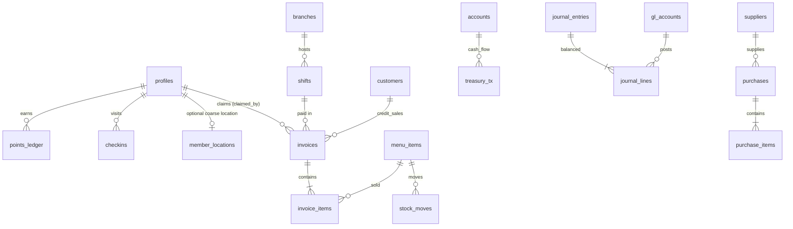

# مخطط قاعدة بيانات المراكشي (Supabase / PostgreSQL)

## ER مبسّط

## الوحدات
| الوحدة | الجداول |
|---|---|
| الهوية والولاء | `profiles` (دور/ستريك)، `points_ledger` (دفتر النقاط: كسب/استبدال/استرجاع)، `checkins`، `app_settings` |
| المنيو والمخزون | `menu_items` (سعر/تكلفة/نقاط/مخزون/حد تنبيه)، `stock_moves` (كل حركة مخزون) |
| المبيعات (POS) | `shifts`, `invoices` (status: open/paid/void/refunded)، `invoice_items` (لقطة سعر وتكلفة ونقاط وقت البيع) |
| المشتريات | `suppliers`, `purchases` (kind: purchase/return)، `purchase_items` |
| الخزن | `accounts` (cash/bank/wallet)، `treasury_tx`، `vouchers` |
| المحاسبة | `gl_accounts` (شجرة حسابات)، `journal_entries`, `journal_lines` (قيد مزدوج، كل قيد متوازن) |
| الفروع والموقع | `branches`، `areas`، `member_locations` (بموافقة العميل، إحداثيات مقرّبة ~٥٠٠م) |
| الرقابة | `audit_logs` |

## القيود المحاسبية التلقائية
- **بيع مدفوع:** مدين (كاش/بنك/محفظة/عملاء) + خصم النقاط، دائن إيراد المبيعات. ومدين تكلفة البضاعة، دائن المخزون.
- **استرجاع فاتورة:** عكس قيد البيع.
- **مشتريات:** مدين المخزون، دائن (الخزنة والمدفوع) وحساب الموردين للباقي. المخزون بمتوسط التكلفة المرجّح.
- **سند قبض/صرف:** حسب الطرف (عميل/مورد/أخرى).
- **مصروف:** مدين حساب المصروف، دائن الخزنة. **جرد:** فرق المخزون على حساب فروق وتالف.

## للتحليل وللمشروع الجامعي
دالة `analytics_export()` بترجّع جداول جاهزة (نجمة): `fact_sales`, `fact_sale_items`, `fact_points`, `dim_members` (بدون اسم/يوزر/تليفون، بمفتاح مستعار SHA-256 + salt)، `dim_items`, `dim_branches`. التصدير من المكتب ← تحليلات العملاء.
أفكار تحليل: سلة المشتريات (market basket) بين الأصناف، تقسيم العملاء (RFM/K-means)، توقّع الطلب بالساعة واليوم، تأثير المسافة من الفرع على التكرار، توقّع التسرّب (churn)، تحسين التسعير.
